<!-- ============ HEADER ============ -->


<div align="center">

<a href="https://github.com/AnanyaSoni2004">
  
</a>

<br/>

<a href="https://www.linkedin.com/in/ananya-soni-699086165"></a>
<a href="mailto:soniananya.2004@gmail.com"></a>


</div>

---

<!-- ============ ABOUT ME (terminal style) ============ -->
<table>
<tr>
<td width="55%" valign="top">

```bash
ananya@ml-lab:~$ whoami
> Ananya Soni — B.Tech CSE (AI specialisation)

ananya@ml-lab:~$ cat interests.txt
> Machine Learning · Deep Learning
> Computer Vision · NLP · Data Science

ananya@ml-lab:~$ ./current_status --verbose
[building]   end-to-end ML projects
[learning]   deep learning & model deployment
[exploring]  real-world AI applications
[status]     ██████████░░  always training...
```

</td>
<td width="45%" align="center">
  
</td>
</tr>
</table>

---

<!-- ============ TECH STACK ============ -->
<h3 align="center">⚡ Tech Arsenal</h3>

<div align="center">

<br/>


<br/><br/>


</div>

---

<!-- ============ STATS ============ -->
<h3 align="center">📊 GitHub Analytics</h3>

<div align="center">
  
  
</div>

<div align="center">
  
</div>

<div align="center">
  
</div>

---

<!-- ============ CONTRIBUTION JOURNEY ============ -->
<h3 align="center">📈 Contribution Journey</h3>

<div align="center">
  
</div>

<h3 align="center">👾 Contributions Pacman</h3>

<div align="center">
  
</div>

---

<div align="center">

> *"Data is the new oil, and machine learning is the refinery."*


</div>
